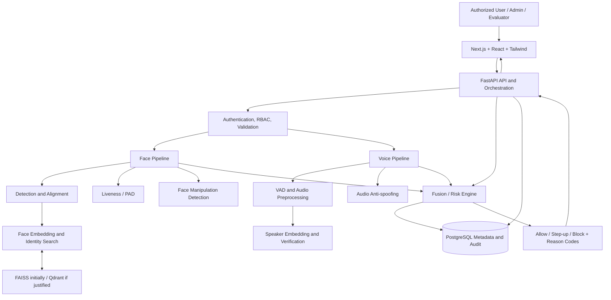
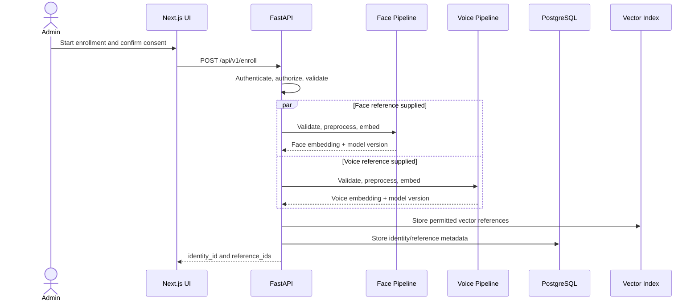
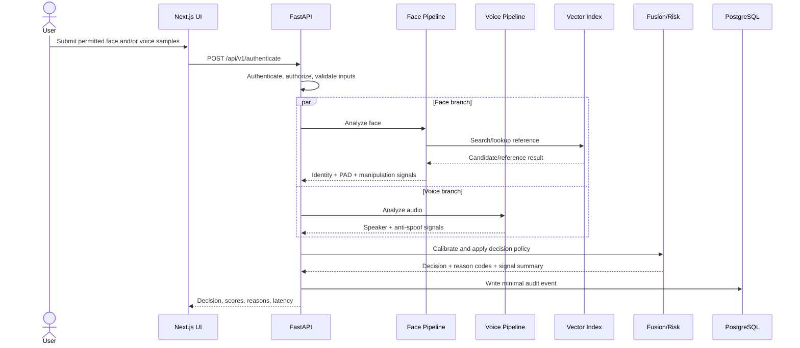

# TrueFace AI-X — Technical Architecture

**Purpose:** Describe the proposed system boundaries, data flow, technology choices, interfaces, and implementation sequence.

> This architecture is based on the approved synopsis. It is a proposed academic prototype architecture, not a statement that the services, models, or APIs already exist. Keep unresolved technology choices configurable and document final decisions in the repository.

---

## 1. Architecture overview

TrueFace AI-X uses a web client, API/orchestration layer, independent face and voice processing branches, a fusion/risk layer, a vector index, and relational metadata/audit storage.



The fusion/risk engine may run as a module inside FastAPI orchestration rather than a separately deployed service.

## 2. Proposed technology stack

| Layer | Proposed technology | Notes |
|---|---|---|
| Frontend | Next.js, React, Tailwind CSS | Enrollment, authentication, dashboard, audit, evaluation |
| API/orchestration | FastAPI | Request validation, auth/RBAC, model orchestration, response |
| Face processing | Python, PyTorch, OpenCV, pretrained model implementations | Detection/alignment, embeddings, PAD, manipulation |
| Voice processing | Python, PyTorch, audio-processing libraries | VAD, preprocessing, speaker embeddings, anti-spoof |
| Vector search | FAISS initially; Qdrant if justified | Controlled test gallery; keep ID mapping |
| Relational data | PostgreSQL | Identity/consent metadata, model references, audit events |
| Model runtime | PyTorch during experimentation; ONNX Runtime where compatible | Conversion only if outputs remain acceptable |
| Testing | pytest, FastAPI TestClient/Postman, Playwright or scripted E2E | Unit, API, model, security, and UI tests |
| Delivery | Git branches/PRs, CI, Docker packaging | Pin dependencies; datasets and model artifacts outside Git by default |

Do not add Redis, Kafka, Kubernetes, microservices, or other infrastructure unless a demonstrated requirement justifies it.

## 3. Component responsibilities

### 3.1 Frontend
- Collect permitted user input and display consent/permission states.
- Submit media to the API over the documented contract.
- Display server-returned modality results, decision, reason codes, and latency.
- Provide administrator audit views and evaluator metric views.
- Never make the authoritative biometric decision in the browser.
- Never contain server secrets or direct database credentials.

### 3.2 FastAPI API/orchestration
- Authenticate application accounts and enforce role-based authorization.
- Validate request shape, media type, file size, duration, and required fields.
- Coordinate model calls and enforce timeouts.
- Normalize modality outputs into typed internal results.
- Invoke the fusion/risk policy.
- Persist minimal audit metadata.
- Return explicit errors and structured results.
- Ensure a failed model call cannot become an Allow decision.

### 3.3 Face pipeline
Proposed sequence:
1. Decode and validate image/video input.
2. Detect face and align/crop as required by the selected model.
3. Check quality and represent missing/low-quality cases explicitly.
4. Generate face embedding.
5. Perform 1:1 comparison or controlled-gallery 1:N retrieval.
6. Run liveness/PAD on supported input types.
7. Run face manipulation/deepfake classification where enabled.
8. Return structured identity and authenticity signals, model versions, and status.

Candidate model families, datasets, and exact preprocessing are TBD. Do not hard-code an unverified model assumption.

### 3.4 Voice pipeline
Proposed sequence:
1. Validate audio format, duration, and size.
2. Run VAD and audio preprocessing.
3. Check quality and supported sample conditions.
4. Generate speaker embedding and compare with the claimed/enrolled reference.
5. Run replay/synthetic-speech anti-spoofing for supported attack classes.
6. Return structured identity and authenticity signals, model versions, and status.

Candidate speaker model family includes ECAPA-TDNN/SpeechBrain as a research starting point; final model and license are TBD.

### 3.5 Vector search
- FAISS is the initial local-prototype option.
- Qdrant is an alternative if a separate vector service is justified.
- Keep a deterministic mapping from vector index IDs to pseudonymous internal identity IDs.
- Document index rebuild and deletion behavior.
- Test mapping integrity and search latency.
- Do not expose raw vector contents through user-facing APIs.

### 3.6 Fusion/risk engine
- Accept typed face and voice result objects, including explicit missing/error states.
- Keep identity and authenticity signals distinct.
- Calibrate scores on validation data.
- Apply a documented, versioned policy.
- Return `allow`, `step_up`, or `block`, plus stable reason codes.
- Preserve modality-level outputs for evaluation.
- Handle conflicting, unavailable, low-quality, and timed-out signals.
- Never default to Allow when required evidence is missing or an inference fails.

Initial experiments may compare rule-based and learned fusion. Exact method and thresholds are TBD; do not invent them.

### 3.7 PostgreSQL
Persist only required metadata:
- Pseudonymous identity and consent status.
- Biometric reference metadata: modality, embedding/model version, protected storage reference.
- Authentication event: event ID, timestamp, decision, reason codes, latency, model versions as appropriate.
- Evaluation run and metrics/configuration references.
- Exact schema and migrations are TBD and must be version-controlled.

Raw media should be transient by default. Any retained media needs explicit approval and a documented retention/deletion policy.

## 4. Data flow

### 4.1 Enrollment flow



### 4.2 Authentication flow



If a branch is unavailable or fails, its status must be represented. The risk policy decides Step-up/Block; it must not silently interpret failure as a positive signal.

## 5. Proposed API contracts

Exact schemas are pending. Use versioned routes:

| Route | Method | Auth | Purpose |
|---|---|---|---|
| `/api/v1/enroll` | POST | Bearer token; administrator role | Consent-based enrollment |
| `/api/v1/authenticate` | POST | Bearer token | Multimodal authentication |
| `/api/v1/verify/face` | POST | Bearer token | Face-only verification |
| `/api/v1/verify/voice` | POST | Bearer token | Voice-only verification |
| `/api/v1/health` | GET | None proposed | Health and loaded model versions |
| `/api/v1/audit` | GET | Bearer token; administrator/evaluator role | Authorized audit query |

### 5.1 Response shape principles

The exact JSON fields must be finalized, but responses should represent:
- Overall decision and stable reason codes.
- Per-modality status: `available`, `missing`, `invalid`, `low_quality`, `timeout`, or `error` as appropriate.
- Separate identity and authenticity results.
- Model/version identifiers.
- Latency with clearly defined measurement boundaries.
- A correlation/event ID where appropriate.

Do not return internal stack traces, secrets, full embeddings, or raw media in ordinary responses.

## 6. Data model (proposed)

| Entity | Important fields | Notes |
|---|---|---|
| `UserIdentity` | `identity_id`, `consent_status` | Pseudonymous internal ID |
| `BiometricReference` | `reference_id`, `identity_id`, `modality`, `embedding_version`, `storage_reference` | Protected reference; raw media avoided by default |
| `AuthenticationEvent` | `event_id`, `identity_id` (nullable where appropriate), `decision`, `reason_codes`, `latency_ms`, timestamp/model versions | Minimal audit record |
| `EvaluationRun` | `run_id`, `dataset_split`, metrics/configuration reference | Reproducibility |
| `ModelVersion` | Proposed model metadata | Exact fields TBD |
| `MetricResult` | Proposed per-run metric records | Exact fields TBD |

Use PostgreSQL migrations. The synopsis proposes `UserIdentity` 1-to-many `BiometricReference`, `UserIdentity` 1-to-many `AuthenticationEvent`, `ModelVersion` 1-to-many `EvaluationRun`, and `EvaluationRun` 1-to-many `MetricResult`. Final relationships are TBD.

## 7. Security, privacy, and failure handling

- Separate application login from biometric verification.
- Enforce authorization on the server for every protected operation.
- Require consent and administrator authorization before enrollment.
- Validate file type, size, duration, and decoded content; do not trust extensions alone.
- Keep secrets in environment variables or an appropriate secret store; never commit them.
- Do not log passwords, raw media, full embeddings, or unnecessary identifying data.
- Restrict access to references and audit records.
- Define retention and deletion behavior; vector index deletion may need explicit handling.
- Use HTTPS in deployed environments.
- Apply rate limits where appropriate.
- Record event ID and timestamp for decisions.
- On timeout, invalid output, or model unavailability, return an explicit error or conservative Step-up/Block result. Never Allow by default.
- Keep datasets and model files outside Git unless size and license explicitly permit.

## 8. Model and dataset workflow

1. Review primary research and official dataset documentation.
2. Verify dataset access terms, license, supported labels, and permitted use.
3. Record counts, class balance, identity/session structure, and preprocessing.
4. Create train/validation/test splits; prevent identity/session leakage where applicable.
5. Build a baseline for each modality/task.
6. Evaluate each task independently.
7. Select thresholds and calibration using validation data.
8. Run fusion experiments.
9. Compare fused results with unimodal baselines on held-out test data.
10. Record model hashes/versions, environment, random seeds, hardware, and configuration.

Candidate references named in the synopsis include InsightFace/ArcFace, RetinaFace, SpeechBrain/ECAPA-TDNN, ASVspoof resources, face PAD and face-manipulation datasets, PyTorch, OpenCV, FastAPI, Next.js, PostgreSQL, FAISS, and Qdrant. Exact model/dataset choices and licenses must be verified before adoption.

## 9. Testing strategy

- **Unit:** preprocessing, score normalization, calibration, fusion policy, reason-code mapping.
- **Model evaluation:** held-out labeled datasets, confusion matrices, ROC/DET, task-specific metrics.
- **Search:** vector-to-identity mapping, retrieval correctness, gallery-size and latency behavior.
- **API integration:** all critical routes, auth/RBAC, malformed uploads, persistence, explicit error paths.
- **Frontend E2E:** enrollment, authentication, result display, audit, permission denial, retry.
- **Security:** malformed inputs, unauthorized access, secrets/dependency scan, audit access.
- **Failure injection:** missing model, timeout, invalid model output, database/index unavailable.
- **Reproducibility:** clean setup and repeatable experiment metadata.

## 10. Performance measurement

Proposed target: p95 ≤ 2 seconds for a defined local test configuration and small controlled gallery. It is not a verified result.

Every report must disclose:
- Hardware and accelerator.
- Model loading inclusion/exclusion.
- Input image/video dimensions and duration.
- Audio duration and sample rate.
- Gallery size and batch size.
- Number of repetitions and warm-up policy.
- Per-stage and end-to-end timing boundaries.

Optimize only after profiling. ONNX Runtime may be considered only when conversion preserves acceptable outputs.

## 11. Repository structure (suggested, not mandated)

```text
TrueFace-AI-X/
├── frontend/                  # Next.js application
├── backend/
│   ├── app/
│   │   ├── api/v1/             # FastAPI routes
│   │   ├── core/               # config, auth, logging
│   │   ├── schemas/            # request/response models
│   │   ├── services/           # orchestration and business logic
│   │   ├── face/               # face pipeline adapters
│   │   ├── voice/              # voice pipeline adapters
│   │   ├── fusion/             # calibration and risk policy
│   │   ├── search/             # FAISS/Qdrant adapter
│   │   └── db/                 # models, repositories, migrations
│   └── tests/
├── evaluation/
│   ├── datasets/               # ignored; no private data in Git
│   ├── configs/
│   ├── scripts/
│   └── reports/
├── docs/
├── infra/                      # Docker/CI configuration
├── .env.example                # names/placeholders only
├── .gitignore
└── README.md
```

Adapt this to the existing repository rather than restructuring blindly. Inspect the current codebase before creating or moving files.

## 12. Environment and configuration

- Use environment variables for configuration and secrets.
- Commit `.env.example` with placeholder values only.
- Separate development and test data.
- Pin Python and Node dependencies.
- Record OS, hardware, package versions, model hashes, and dataset versions for reproducibility.
- Never place credentials, biometric samples, or licensed datasets in Git.

## 13. Delivery sequence

1. Requirements and dataset/license plan.
2. Architecture, schema/API contracts, and development setup.
3. Face identity/search baseline.
4. Face PAD/manipulation evaluation.
5. Voice verification/anti-spoof baseline.
6. Score calibration and fusion experiments.
7. API, database, and audit integration.
8. Frontend integration.
9. End-to-end, security, and performance tests.
10. Final prototype, evaluation report, demo, and documentation.

A face-only baseline is the planned scope-control fallback if voice/fusion work is blocked by time, compute, data, or feasibility.

## 14. Open decisions

Maintain a decision log for:
- Final model architectures/checkpoints and licenses.
- Dataset selection and access conditions.
- Face/voice preprocessing details.
- Thresholds, calibration, and fusion method.
- API schemas and auth implementation.
- PostgreSQL schema and migration tool.
- FAISS versus Qdrant.
- Retention duration, deletion policy, and volunteer-data approval.
- Hardware and benchmark configuration.
- Final deployment and packaging details.
