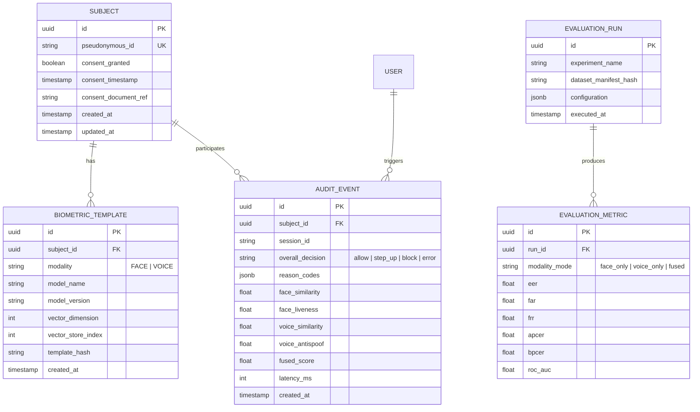

# TrueFace AI-X — Database Schema & Data Models

**Database Engine:** PostgreSQL 16+  
**ORM:** SQLAlchemy 2.0 (Async) + Alembic for migrations  
**Privacy Requirement:** Never store raw biometric images, raw audio buffers, or plaintext keys in database tables.

---

## 1. Entity Relationship Overview

---

## 2. Table Specifications

### 2.1 `subjects`
Maintains pseudonymous identities created for research evaluation with explicit consent tracking.

| Column | Type | Constraints | Description |
|---|---|---|---|
| `id` | UUID | Primary Key | Internal system UUID |
| `pseudonymous_id` | VARCHAR(64) | Unique, Not Null | Public research identifier (e.g. `subj_001`) |
| `consent_granted` | BOOLEAN | Not Null | Affirmative consent indicator |
| `consent_timestamp` | TIMESTAMPTZ | Not Null | When consent was logged |
| `is_active` | BOOLEAN | Default: True | Soft delete indicator |
| `created_at` | TIMESTAMPTZ | Default: NOW() | Registration date |

### 2.2 `biometric_templates`
Stores template pointers and index references for vector search (FAISS/Qdrant).

| Column | Type | Constraints | Description |
|---|---|---|---|
| `id` | UUID | Primary Key | Template ID |
| `subject_id` | UUID | Foreign Key (`subjects.id`) | Enrolled subject reference |
| `modality` | VARCHAR(16) | Not Null | `FACE` or `VOICE` |
| `model_name` | VARCHAR(64) | Not Null | Model architecture name |
| `model_version` | VARCHAR(32) | Not Null | Checkpoint version/hash |
| `vector_store_index` | INTEGER | Nullable | Index position in FAISS vector store |
| `template_hash` | VARCHAR(64) | Not Null | SHA-256 hash of embedding |
| `created_at` | TIMESTAMPTZ | Default: NOW() | Enrollment date |

### 2.3 `audit_events`
Stores verification events for forensic review and explanation without recording raw media.

| Column | Type | Constraints | Description |
|---|---|---|---|
| `id` | UUID | Primary Key | Unique event ID |
| `session_id` | VARCHAR(64) | Indexed, Not Null | Request correlation ID |
| `subject_id` | UUID | Nullable, FK (`subjects.id`) | Claimed subject ID |
| `overall_decision` | VARCHAR(16) | Not Null | `allow`, `step_up`, `block`, `error` |
| `reason_codes` | JSONB | Not Null | Machine-readable explanation tags |
| `face_similarity` | REAL | Nullable | 1:1 face match score |
| `face_liveness` | REAL | Nullable | PAD liveness probability |
| `voice_similarity` | REAL | Nullable | Speaker similarity score |
| `voice_antispoof` | REAL | Nullable | Audio genuineness score |
| `fused_score` | REAL | Nullable | Fused risk/identity score |
| `latency_ms` | INTEGER | Not Null | Pipeline execution duration |
| `created_at` | TIMESTAMPTZ | Default: NOW(), Indexed | Event timestamp |

---

## 3. Retention & Deletion Policy

1. **Deletion on Request:** When a volunteer or subject withdraws consent, their database records are marked inactive, their entry in the vector store index is deleted, and the index is re-compacted.
2. **Audit Preservation:** Audit event records retain pseudonymous references for model calibration audits but contain no raw biometric features.

